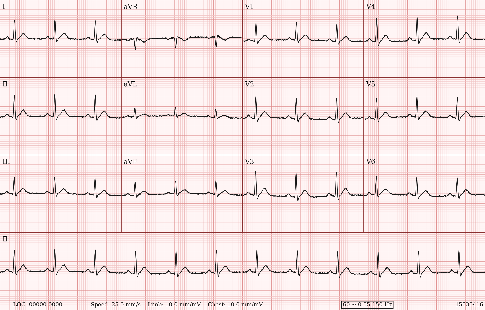
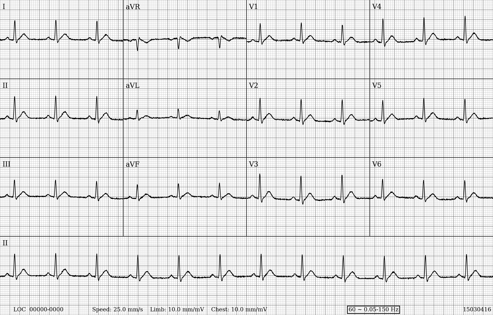

# ecg-plotter

Plot 12-lead ECGs as classic clinical-style sheets with **settable physical size or pixel resolution**, **DPI**, optional **signal filters**, and accurate **mm/s / mm/mV** footer reporting.

**Research / visualisation only — not for diagnostic use.** This package renders ECG traces for research, teaching, and ML dataset creation. It is not a medical device and must not be used for clinical diagnosis or patient care.

**Author:** Jarod P. Hartley ([ORCID](https://orcid.org/0009-0006-0736-5100)), Swansea University — jarodph.contact@gmail.com

If you use this software, please cite it:

Hartley, J. P. (2026). *ecg-plotter*. Zenodo. https://doi.org/10.5281/zenodo.23984258



## Install

```bash
pip install ecg-plotter
```

Dependencies, installed automatically: `numpy`, `pandas`, `scipy`, `matplotlib`, `Pillow`, `wfdb`.

## Quick start

```python
import ecg_plotter as ecg

data = ecg.load_wfdb("path/to/record")  # without .hea/.dat extension
leads, fs = data["leads"], data["fs"]

# Option A: filter inside plot (notch/bandpass from the same kwargs)
ecg.plot(
    leads,
    "out.png",
    inches=(9.84, 6.3),   # or resolution=(2952, 1890)
    dpi=300,              # default 300
    fs=fs,
    colour=True,          # pink RGB paper; False → 1-channel greyscale
    id=data["record_name"],
    anonymise=True,
    filter=True,          # apply notch/bandpass; False → footer text only
    notch_hz=60,
    bandpass_hz=(0.05, 150),
)

# Option B: filter yourself first (median / custom chains)
# leads = ecg.apply_to_leads(leads, ecg.median_baseline, kernel_size=201)
# ecg.plot(leads, "out.png", ..., filter=False, notch_hz=60, bandpass_hz=(0.05, 150))
```

## Size and calibration

Provide **either** `inches=(width, height)` **or** `resolution=(width_px, height_px)`.

- Resolution → inches via `pixels / dpi`
- Default DPI is **300**
- Footer speed / gain are computed from the **saved** geometry:

```text
duration_s = n_samples / fs
speed_mm/s = (width_px / dpi) * 25.4 / duration_s
gain_mm/mV = (height_px / dpi) * 25.4 / 16
```

At a fixed recording length, a larger page increases mm/s. A taller page increases mm/mV. The footer prints those computed values.

## Filters

| Function / option | Role |
|---|---|
| `plot(..., filter=True)` | Apply `notch_hz` / `bandpass_hz` inside `plot`; with `filter=False` those kwargs only set the footer text |
| `bandpass` | Butterworth band-pass (default 0.05–150 Hz) |
| `notch` | IIR mains notch (50/60 Hz) |
| `median_baseline` | Median-filter baseline subtraction |
| `apply_to_leads` | Map any 1-D filter across leads (dict / array / DataFrame) |

Notch and band-pass run forward and back, so the QRS is not shifted in time. The default band-pass needs more than about 28 samples. A shorter trace raises `ValueError`.

## Colour vs greyscale

- `colour=True` → pink ECG-paper grid
- `colour=False` → greyscale grid
- PNG colour is RGB (3 channels); PNG greyscale is mode `L` (1 channel)

## Output formats

`plot` writes **PNG**, **PDF**, or **SVG** (inferred from the file extension, or set `format=`):

```python
ecg.plot(leads, "sheet.pdf", inches=(9.84, 6.3), fs=fs)  # vector PDF
ecg.plot(leads, "sheet.svg", inches=(9.84, 6.3), fs=fs)
ecg.plot(leads, "sheet.png", resolution=(2952, 1890), dpi=300, fs=fs)
```

## CLI

```bash
ecg-plotter path/to/record -o out.pdf --inches 9.84 6.3 --anonymise --filter --notch-hz 60 --bandpass-hz 0.05 150
ecg-plotter --jsonl examples/data/synthetic_data.jsonl --index 0 -o out.svg --greyscale
ecg-plotter --version
```

## Anonymisation

For ML dataset creation, set `anonymise=True` so the footer ID is always the fixed placeholder `15030416` instead of a real record ID (which models can overfit on).

## Input formats

Amplitudes are in millivolts. `load_wfdb` reads WFDB `p_signal`.

`plot` and `apply_to_leads` accept:

- `dict[str, array]` with lead names (`I`, `II`, … `V6`)
- `ndarray` of shape `(12, n)` or `(n, 12)` (default name order: `LEAD_NAMES`)
- `pandas.DataFrame` with lead columns:
  - **wide**: rows = samples, columns = lead names
  - **single-row**: one row whose lead cells contain arrays/lists (e.g. from JSONL)
  - **12 columns and no lead names**: the columns are taken in order as `LEAD_NAMES`, and a warning is issued. Pass `lead_names=` if that order is wrong. Any other unlabelled table is rejected.

```python
import pandas as pd

df = pd.DataFrame(
    {
        "I": signal["I"],
        "II": signal["II"],
        "III": signal["III"],
        "aVR": signal["aVR"],
        "aVL": signal["aVL"],
        "aVF": signal["aVF"],
        "V1": signal["V1"],
        "V2": signal["V2"],
        "V3": signal["V3"],
        "V4": signal["V4"],
        "V5": signal["V5"],
        "V6": signal["V6"],
    }
)  # shape: (n_samples, 12)
ecg.plot(df, "out.png", inches=(9.84, 6.3), fs=500)
```

JSON Lines records from `load_jsonl` must include a positive ``fs`` field (Hz). The CLI uses that value unless ``--fs`` overrides it.

## Layout

Classic sheet:

```text
I    aVR   V1   V4
II   aVL   V2   V5
III  aVF   V3   V6
─── II rhythm ────
```

Column width and sample count scale with the recording length (split into four equal segments). If the sample count is not divisible by 4, the last 1–3 samples are dropped so every column has the same duration, and a warning is raised. Sampling rate drives grid spacing (major ≈ 0.2 s).

## Examples

Sample data in `examples/data/` is **synthetic only** (no real patient recordings).
Regenerate with `python examples/data/generate_synthetic.py`.

```bash
python examples/plot_from_wfdb.py
python examples/plot_from_dataframe.py
python examples/plot_from_jsonl.py
python examples/plot_colour_and_greyscale.py
python examples/plot_low_dpi.py
python examples/plot_nonstandard_calibration.py
python examples/plot_with_standalone_filters.py
python examples/plot_pdf_and_svg.py
```

| Script | Shows |
|---|---|
| `plot_from_wfdb.py` | Load synthetic WFDB `synth_0001`, filter inside `plot`, colour PNG |
| `plot_from_dataframe.py` | Build an explicit lead DataFrame and plot it |
| `plot_from_jsonl.py` | Load the first record from `synthetic_data.jsonl` |
| `plot_colour_and_greyscale.py` | Inches vs resolution, colour vs greyscale |
| `plot_low_dpi.py` | Same physical size at 150 DPI (smaller pixel dimensions) |
| `plot_nonstandard_calibration.py` | Non-standard sizes. Footers report about 50 mm/s with 5 mm/mV, and about 20 mm/s with 12.5 mm/mV |
| `plot_with_standalone_filters.py` | Filter with `apply_to_leads`, then `plot(..., filter=False)` |
| `plot_pdf_and_svg.py` | Vector outputs: colour PDF and greyscale SVG |

Outputs are written to `examples/output/`.



## Tests

```bash
pip install -e ".[dev]"
pytest
```

GitHub Actions runs these commands on Python 3.9, 3.11, and 3.12.
